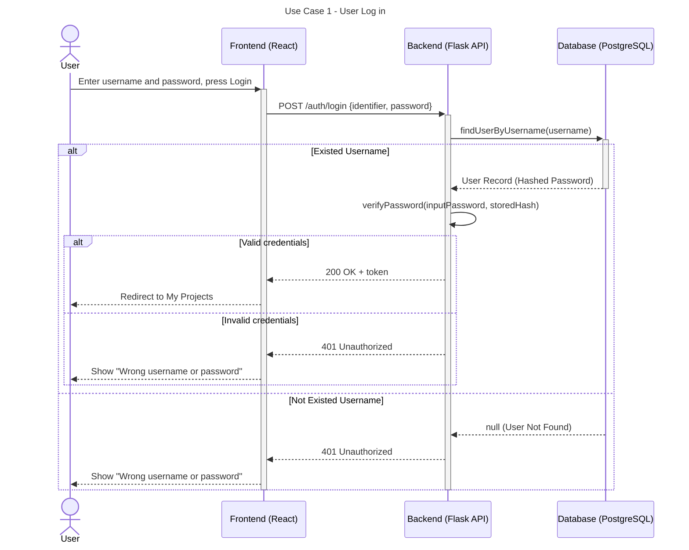

# Sequence Diagrams

## Use Case 1: User Log in

This sequence diagram illustrates the user login authentication process, including database checks and password verification.


---



---
### Detailed Flow Breakdown

1. **Client Request:** The user submits their login credentials via the React frontend.
2. **API Dispatch:** The frontend sends an HTTP `POST` request to `/auth/login` containing the JSON payload with `{ identifier, password }`.
3. **User Lookup:** The Flask API queries PostgreSQL to find the user record by username.
4. **Credential Verification:**
   - **If user exists:** The API fetches the stored password hash and compares it with the input password.
   - **If hash matches:** Generates a session JWT token and responds with HTTP `200 OK`.
   - **If hash fails OR user is not found:** Immediately halts execution and returns HTTP `401 Unauthorized`.
5. **UI Redirection / Error Handling:** 
   - On `200 OK`: Frontend stores the token and redirects the user to the dashboard (`/projects`).
   - On `401 Unauthorized`: Frontend displays responses and identical error messages for both non-existent users and invalid passwords to protect against account enumeration attacks.

---

### API Specification

#### `POST /auth/login`

**Request Payload:**
```json
{
  "identifier": "johndoe",
  "password": "securepassword123"
}
