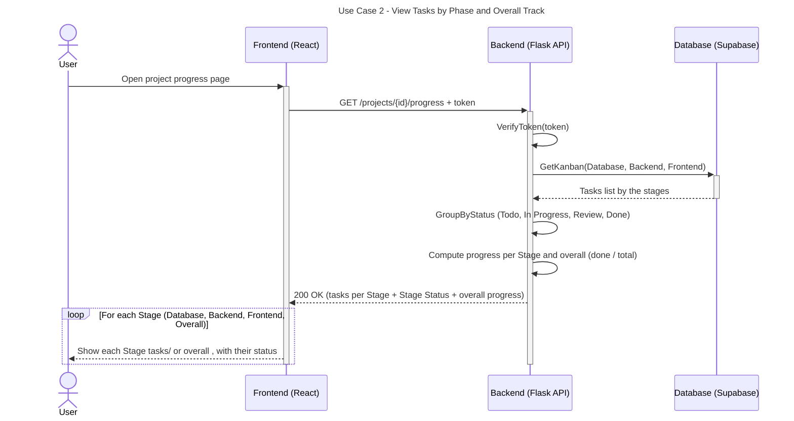

# Sequence Diagrams

## Use Case 2: View Tasks by Phase and Overall Track.

This sequence diagram illustrates the workflow for retrieving and displaying project tasks grouped by phases and stages, along with calculating completion progress across individual stages and the overall track.

---

---
### Detailed Flow Breakdown

1. **Client Request:** The user navigates to the project progress page via the React frontend.
2. **API Dispatch:** The frontend sends an HTTP `GET` request to `/projects/{id}/progress` including the user's authentication token in the request header.
3. **Token Verification:** The Flask API verifies the validity of the provided JWT token to ensure authorized access.
4. **Data Retrieval & Processing:**
   - **Database Query:** The API queries PostgreSQL (`GetKanban`) to retrieve all tasks categorized across project phases/tracks (Database, Backend, Frontend).
   - **Task Grouping:** The API groups tasks by their current status (`Todo`, `In Progress`, `Review`, `Done`).
   - **Progress Calculation:** The backend computes the completion metrics (calculated as `done / total`) both per stage and for overall project progress.
5. **API Response & UI Rendering:**
   - **Response Generation:** The API returns an HTTP `200 OK` status with a payload containing grouped tasks, stage-specific completion statuses, and overall progress metrics.
   - **Component Rendering:** The React frontend loops through each stage to display the tasks, stage statuses, and overall progress metrics to the user.

