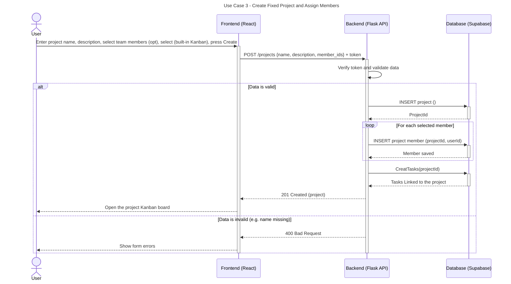

# Sequence Diagrams

## Use Case 3: create template project

This sequence diagram illustrates the workflow for creating a fixed project using a built-in Kanban template, associating selected team members, and generating default tasks upon project initialization.

---

---
### Detailed Flow Breakdown

1. **Client Request:** The user fills out the project creation form (providing name, description, optional team members, and selecting the built-in Kanban template) and clicks Create via the React frontend.
2. **API Dispatch:** The frontend sends an HTTP `POST` request to `/projects` containing the JSON payload with `{ name, description, member_ids }` along with the authorization token in the request header.
3. **Validation & Authorization:** The Flask API verifies the user's JWT token and validates the incoming data (e.g., checking that the project name is provided).
4. **Data Persistence Flow:**
   - **Project Insertion:** Upon successful validation, the backend inserts the new project record into PostgreSQL and receives the generated `projectId`.
   - **Member Assignment:** The backend iterates over each selected team member in `member_ids` and inserts a project member record linking `projectId` and `userId`.
   - **Task Creation:** The backend calls `CreatTasks(projectId)` to populate the project with the built-in Kanban tasks in PostgreSQL.
5. **API Response & UI Redirection:**
   - **On Success (`201 Created`):** The API returns an HTTP `201 Created` status with the new project data, and the frontend redirects the user to the newly created project's Kanban board.
   - **On Validation Error (`400 Bad Request`):** If any required data is missing or invalid, the API responds with an HTTP `400 Bad Request`, prompting the frontend to display validation errors.
