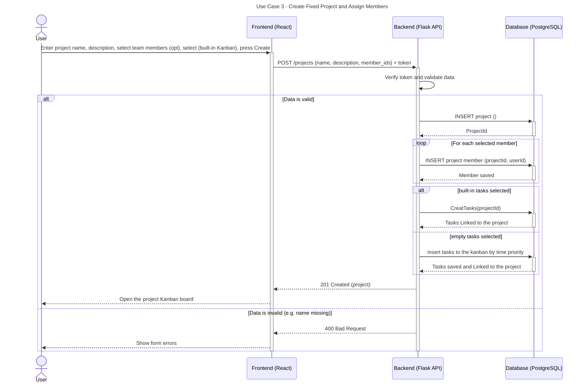

# Sequence Diagrams

## Use Case 3: create template project

This sequence diagram illustrates the user login authentication process, including database checks and password verification.

---

---
### Detailed Flow Breakdown

1. **Client Request:** The user fills out the project creation form (providing name, description, optional team members, and template preferences) and submits it via the React frontend.
2. **API Dispatch:** The frontend sends an HTTP `POST` request to `/projects` containing the JSON payload with `{ name, description, member_ids, template_type }` along with the authorization token in the request header.
3. **Validation & Authorization:** The Flask API verifies the user's JWT token and validates the payload (e.g., ensuring required fields like project name are present).
4. **Data Persistence Flow:**
   - **Project Insertion:** Upon successful validation, the backend inserts the core project details into PostgreSQL and receives the generated `projectId`.
   - **Member Assignment:** The backend iterates through the provided `member_ids` list and links each user to the project in the database.
   - **Task Initialization:** Depending on user selection:
     - *Built-in tasks selected:* Pre-configured default tasks are created and linked to the project.
     - *Custom/Empty tasks selected:* Initial tasks are ordered and inserted into the Kanban board based on time priority.
