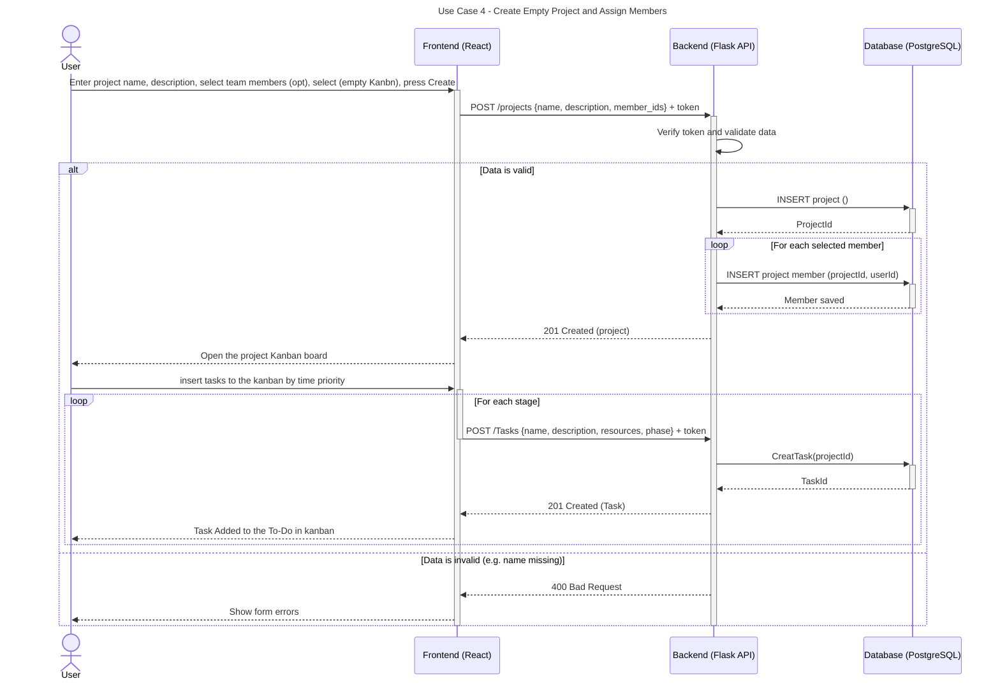

# Sequence Diagrams

## Use Case 4: create custom project

This sequence diagram illustrates the user creating a new project with an empty Kanban board, optionally assign team members, and dynamically add tasks one by one based on time priority.

---

---
### Detailed Flow Breakdown

1. **Client Request:** The user fills out the project creation form (providing name, description, optional team members, and selecting an empty Kanban template) and clicks Create via the React frontend.
2. **API Dispatch:** The frontend sends an HTTP `POST` request to `/projects` containing the JSON payload with `{ name, description, member_ids }` along with the authorization token in the request header.
3. **Validation & Authorization:** The Flask API verifies the user's JWT token and validates the input data (e.g., checking that required fields like the project name are provided).
4. **Project Creation & Member Assignment:**
   - **Project Insertion:** Upon successful validation, the backend inserts the new project record into PostgreSQL and receives the generated `projectId`.
   - **Member Assignment:** The backend loops over each selected member in `member_ids` and inserts a project member record linking `projectId` and `userId`.
5. **Initial Project Setup & Dynamic Task Creation:**
   - **Project Initialized (`201 Created`):** The API responds with HTTP `201 Created`, and the frontend navigates the user to their empty Kanban board.
   - **Task Addition Loop:** The user creates custom tasks ordered by time priority. For each task/phase, the frontend sends a `POST /Tasks` request containing `{ name, description, resources, phase }`.
   - **Task Persistence (`201 Created`):** The API invokes `CreatTask(projectId)`, inserts the task into PostgreSQL, and responds with HTTP `201 Created`, prompting the frontend to render the new task under the "To-Do" column.
6. **Error Handling (`400 Bad Request`):** If initial form data is invalid, the API returns an HTTP `400 Bad Request`, and the frontend displays the relevant validation errors to the user.
